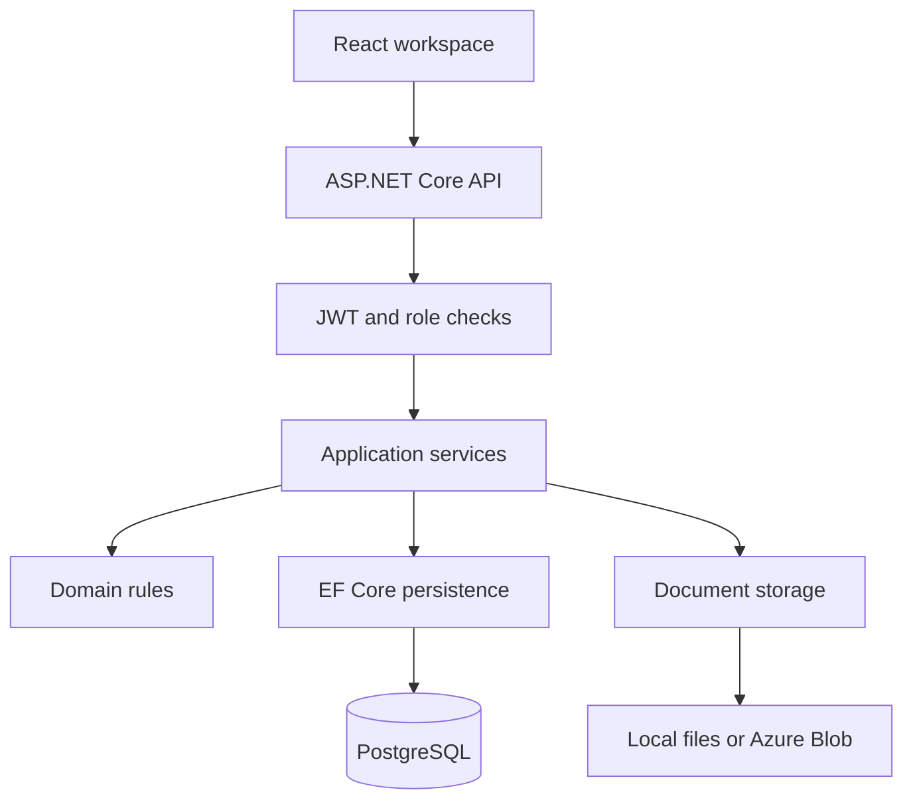

# Aegis Claims

**A claim has a history. Every action has an access boundary.**

A React/TypeScript claims workspace backed by ASP.NET Core and PostgreSQL. Create customers, policies and claims; review evidence; inspect recorded status changes.

**[Open the application](https://claims-management-ync9.onrender.com/)** · [Design decisions](docs/engineering-decisions.md) · [Security assessment](docs/security/assessment-report.md) · [API & setup](docs/application-guide.md)

## Where the rules live



The API enforces authorization. Client route guards and role-aware controls help users navigate; they do not grant access. Frontend and API ship in one container and share an origin.

## Three decisions to inspect

| Concern | Implemented behavior | Evidence |
| --- | --- | --- |
| Status changes | Only Manager/Admin can change a defined status; changes add history, repeated status is a no-op. | [Controller](src/Claims.API/Controllers/ClaimsController.cs), [service](src/Claims.Application/Claims/ClaimService.cs) |
| Uploaded evidence | PDF/JPEG/PNG size, name, declared type and file signature are validated. | [Threat model](docs/security/threat-model.md) |
| Persistence | Separate domain, application, infrastructure and HTTP layers; PostgreSQL deployment with a SQL Server development option. | [Trade-offs](docs/engineering-decisions.md) |

This is defined-status validation, **not a strict lifecycle state machine**. Tenant ownership and optimistic concurrency are not implemented.

## Verification that distinguishes the layers

The recorded backend run passed **22 tests**: 11 domain/application, eight HTTP integration and three real PostgreSQL tests. HTTP tests use EF InMemory; the PostgreSQL suite checks unique/foreign-key constraints and rollback. Neither establishes SQL Server parity or concurrency safety.

[Verification record](docs/verification-results.md) · [Run the tests](docs/verification.md) · [HTTP tests](tests/Claims.IntegrationTests/) · [PostgreSQL tests](tests/Claims.PostgresTests/)

Frontend checks and a Playwright authentication journey run in CI. CodeQL, Trivy and ZAP workflows supplement the [source-assisted security assessment](docs/security/assessment-report.md); they are not security certification.

## Run locally

Requires **Docker Desktop, .NET 10 SDK and Node.js 24**.

```sh
git clone https://github.com/hajarmrifag/claims-management-api.git
cd claims-management-api
./run.sh
```

Open **http://localhost:5173**. The launcher starts SQL Server and both application processes. [Quality checks, endpoint reference and deployment](docs/application-guide.md).

For the live demo, register from the sign-in page to receive the Adjuster role. The free instance may need time to wake. Uploaded files use ephemeral container storage and can disappear after a restart; the Azure Blob provider is available for durable storage. [Remaining risks and planned improvements](docs/application-guide.md#security-and-operational-boundaries).
